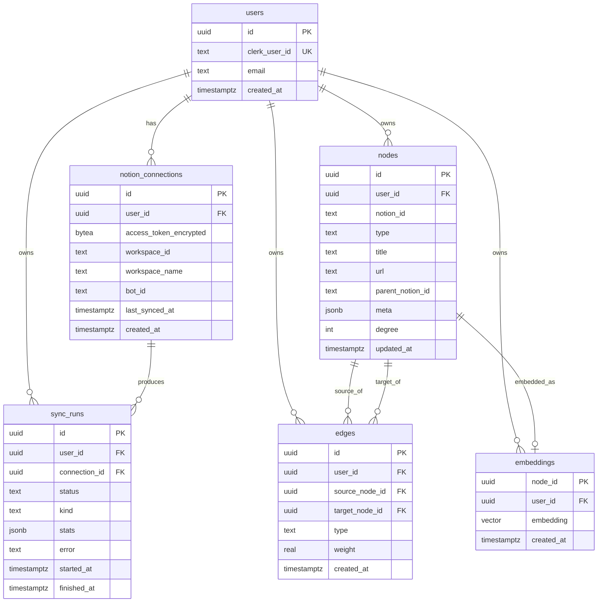

# Schema Design — NotionGraph

**Last updated:** 2026-06-20

> ✅ **Status:** the 5 core tables below are **LIVE** in Supabase (migrations
> `init_core_schema` → superseded by `reset_and_init_core_schema`, which first dropped the
> abandoned earlier attempt's tables). RLS is **enabled** on all of them with **no policies
> yet** (locked down; server uses the service-role key). Generated types live in
> `src/lib/supabase/database.types.ts`. The `embeddings`/pgvector table (§2.6) is **not yet
> created** — deferred to Phase 7.

This is the **single source of truth** for the database. The graph product *is* this schema
made visual, so accuracy here matters more than anywhere else.

> **Rule:** Any schema change must (1) update this file, (2) ship a Supabase migration, and
> (3) regenerate TypeScript types. Never let the DB and this doc drift. (See `RULES.md` §6.)

Conventions: tables/columns are `snake_case`; every user-owned row carries `user_id` and is
guarded by **Row-Level Security**; timestamps are `timestamptz` defaulting to `now()`.

---

## 1. Entity-Relationship Overview



---

## 2. Tables

### 2.1 `users`
Mirror of the Clerk user; created on first sign-in / via Clerk webhook.

| Column | Type | Notes |
|--------|------|-------|
| `id` | `uuid` PK | `default gen_random_uuid()` |
| `clerk_user_id` | `text` | **unique**, not null — link to Clerk |
| `email` | `text` | not null |
| `created_at` | `timestamptz` | `default now()` |

Indexes: unique on `clerk_user_id`.

---

### 2.2 `notion_connections`
One Notion workspace authorization per row. A user may reconnect/replace; v1 assumes one
active connection per user but the schema allows many.

| Column | Type | Notes |
|--------|------|-------|
| `id` | `uuid` PK | |
| `user_id` | `uuid` FK → `users.id` | not null, `on delete cascade` |
| `access_token_encrypted` | `text` | **encrypted at rest** — base64 AES-256-GCM payload from `lib/crypto.ts`; never store plaintext |
| `workspace_id` | `text` | Notion workspace id |
| `workspace_name` | `text` | display name |
| `bot_id` | `text` | Notion bot/integration id |
| `last_synced_at` | `timestamptz` | nullable until first sync |
| `created_at` | `timestamptz` | `default now()` |

Indexes: `(user_id)`. **Never** select `access_token_encrypted` into client-facing queries.

---

### 2.3 `nodes`
One row per Notion object we visualize (page, database, or database row).

| Column | Type | Notes |
|--------|------|-------|
| `id` | `uuid` PK | our internal id (what edges reference) |
| `user_id` | `uuid` FK → `users.id` | not null, cascade |
| `notion_id` | `text` | Notion's object id |
| `type` | `text` | enum-like: `page` \| `database` \| `row` \| `tag` |
| `title` | `text` | display label |
| `url` | `text` | Notion deep link ("Open in Notion") |
| `parent_notion_id` | `text` | Notion id of parent (for nesting edges); nullable |
| `meta` | `jsonb` | icon, last_edited_time, db id, raw props — flexible bag |
| `degree` | `int` | cached connection count (node size); `default 0` |
| `updated_at` | `timestamptz` | `default now()` |

Constraints/Indexes:
- **Unique** `(user_id, notion_id)` — idempotent upserts during sync.
- Index `(user_id, type)` for filtering.
- `type` enforced via a `check` constraint (or a Postgres enum).

> `degree` is denormalized for render performance — recomputed at the end of each sync.

---

### 2.4 `edges`
One row per relationship between two nodes. **This table is the accuracy-critical core.**

| Column | Type | Notes |
|--------|------|-------|
| `id` | `uuid` PK | |
| `user_id` | `uuid` FK → `users.id` | not null, cascade |
| `source_node_id` | `uuid` FK → `nodes.id` | not null, cascade |
| `target_node_id` | `uuid` FK → `nodes.id` | not null, cascade |
| `type` | `text` | `child` \| `mention` \| `relation` \| `semantic` |
| `weight` | `real` | strength (1 default; semantic = similarity score) |
| `created_at` | `timestamptz` | `default now()` |

Constraints/Indexes:
- **Unique** `(user_id, source_node_id, target_node_id, type)` — no duplicate edges.
- Index `(user_id, source_node_id)` and `(user_id, target_node_id)` for neighbor lookups.
- `check (source_node_id <> target_node_id)` — no self-loops.

#### Edge directionality
Edges are stored **directed** (source → target) but the graph renders them as
**undirected** by default. Direction is preserved so we can show it later if useful
(e.g., "A mentions B").

---

### 2.5 `sync_runs`
Audit + progress record for every sync job. Powers the UI's progress, "last synced", and
failure handling.

| Column | Type | Notes |
|--------|------|-------|
| `id` | `uuid` PK | |
| `user_id` | `uuid` FK → `users.id` | not null, cascade |
| `connection_id` | `uuid` FK → `notion_connections.id` | cascade |
| `status` | `text` | `queued` \| `running` \| `success` \| `partial` \| `failed` |
| `kind` | `text` | `initial` \| `incremental` \| `embed` |
| `stats` | `jsonb` | `{ pages, databases, rows, edges, added, updated, removed }` |
| `error` | `text` | nullable; message on failure |
| `started_at` | `timestamptz` | `default now()` |
| `finished_at` | `timestamptz` | nullable until done |

Index: `(user_id, started_at desc)` for "recent syncs".

---

### 2.6 `embeddings` (Phase 7 — pgvector)
One vector per node for AI "semantic" suggested edges. Requires `create extension vector`.

| Column | Type | Notes |
|--------|------|-------|
| `node_id` | `uuid` PK FK → `nodes.id` | cascade |
| `user_id` | `uuid` FK → `users.id` | not null, cascade |
| `embedding` | `vector(1536)` | dimension depends on chosen model; isolate behind `embed()` |
| `created_at` | `timestamptz` | `default now()` |

Index: ivfflat/hnsw on `embedding` for cosine similarity (`vector_cosine_ops`), added when
the table is populated.

---

## 3. Notion → Edge Mapping (the important part)

How a real Notion relationship becomes an `edges` row. This is what "accuracy" in the PRD
(≥95% of explicit links) is measured against.

| Notion relationship | Detected from | `edges.type` | source → target |
|---------------------|---------------|--------------|-----------------|
| **Page nesting** (sub-page) | block/page `parent` | `child` | parent → child |
| **Database → row** | row's `parent.database_id` | `child` | database → row |
| **Inline `@page` mention** | `mention` objects in block content | `mention` | containing page → mentioned page |
| **Inline page link** | link blocks / link_to_page | `mention` | containing page → linked page |
| **Relation property** | DB `relation` property values | `relation` | row → related row |
| **(later) Semantic similarity** | pgvector cosine ≥ threshold | `semantic` | node ↔ node |

Rules:
- Only create an edge when **both** endpoints exist as `nodes` for that user (skip links to
  pages the integration can't access).
- Deduplicate via the unique constraint; if the same pair is linked multiple ways, keep one
  edge per `type`.
- `weight`: `child`/`mention`/`relation` = `1`; `semantic` = the similarity score (0–1).

---

## 4. Row-Level Security (every user-owned table)

Enable RLS and apply the same ownership policy to `notion_connections`, `nodes`, `edges`,
`sync_runs`, `embeddings`. The authenticated user's id is resolved from the Clerk session →
`users.id`.

```sql
alter table nodes enable row level security;

create policy "owner can read"  on nodes for select
  using  (user_id = auth_user_id());

create policy "owner can write" on nodes for all
  using  (user_id = auth_user_id())
  with check (user_id = auth_user_id());
```

- `auth_user_id()` = a helper that maps the request's Clerk identity to `users.id`
  (implementation depends on the Clerk↔Supabase wiring chosen in Phase 1/2).
- Server-side sync jobs use the **service role** (bypasses RLS) but must still set `user_id`
  correctly on every insert — RLS is the safety net, correct `user_id` is the contract.
- **Test:** user A must get zero rows when querying user B's data (Phase 2 RLS tests).

---

## 5. The Render Contract (`GraphData`)

The renderer (react-force-graph today, possibly Cosmograph later) consumes a **stable**
shape, decoupled from storage. Storage can evolve; this contract should not break without
intent.

```ts
// types/graph.ts
export type NodeType = "page" | "database" | "row" | "tag";
export type EdgeType = "child" | "mention" | "relation" | "semantic";

export interface GraphNode {
  id: string;          // = nodes.id
  title: string;
  type: NodeType;
  url: string;         // Open in Notion
  degree: number;      // drives node size
}

export interface GraphLink {
  source: string;      // GraphNode.id
  target: string;      // GraphNode.id
  type: EdgeType;
  weight: number;
}

export interface GraphData {
  nodes: GraphNode[];
  links: GraphLink[];  // react-force-graph calls edges "links"
}
```

> Map `edges` → `links` (note the naming) at the query/serialization boundary, not in the
> component. Keep the component dumb so the engine is swappable.

---

## 6. Lifecycle Summary
1. **Sign in** → upsert `users`.
2. **Connect Notion** → insert `notion_connections` (encrypted token).
3. **initial-sync** (Trigger.dev) → upsert `nodes`, derive + upsert `edges`, recompute
   `degree`, write `sync_runs`, set `last_synced_at`.
4. **Read graph** → select `nodes` + `edges` (RLS-scoped) → serialize to `GraphData`.
5. **incremental-sync** → diff & reconcile (add/update/remove), new `sync_runs`.
6. **(Phase 7)** embed-content → `embeddings` → `semantic` edges.
7. **Delete my data / disconnect** → cascade delete via FKs.
